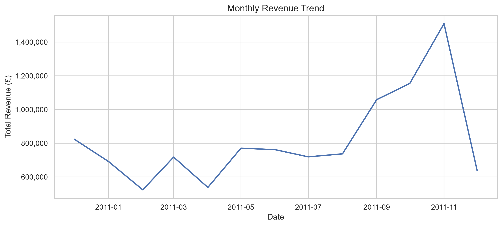
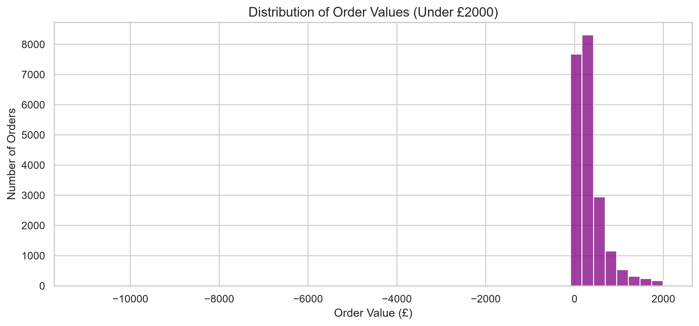
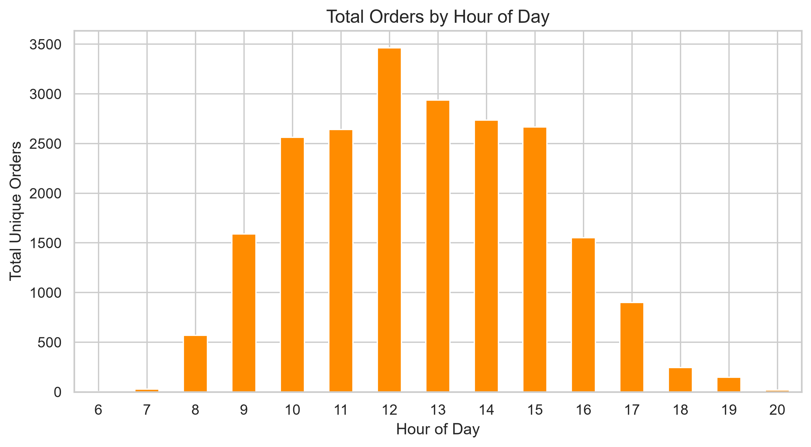
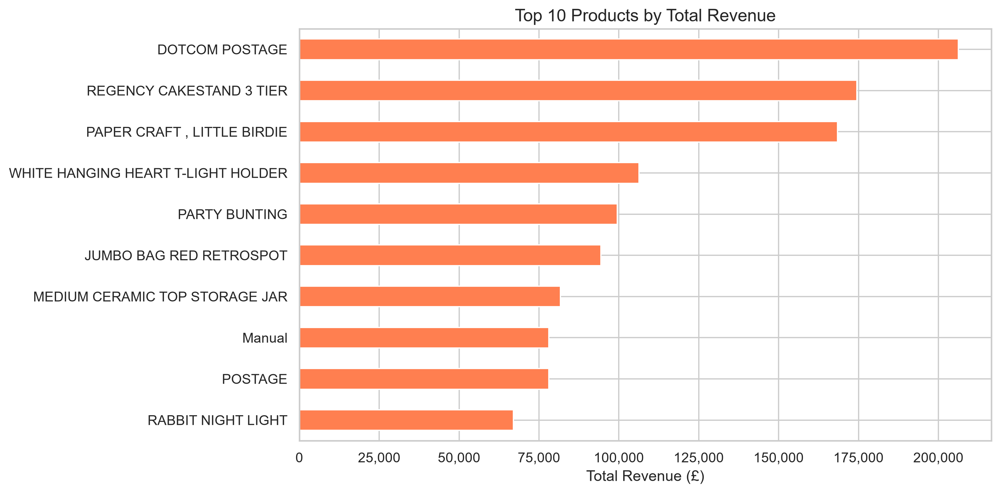
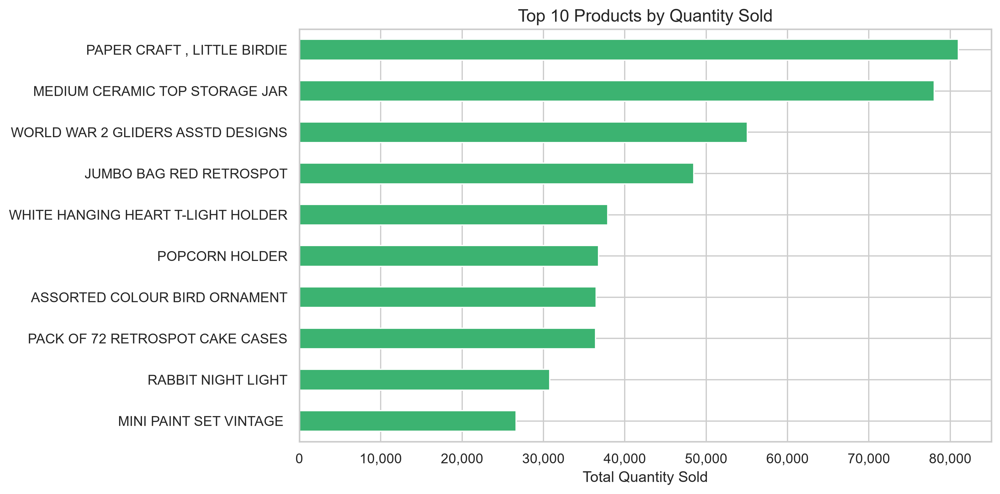
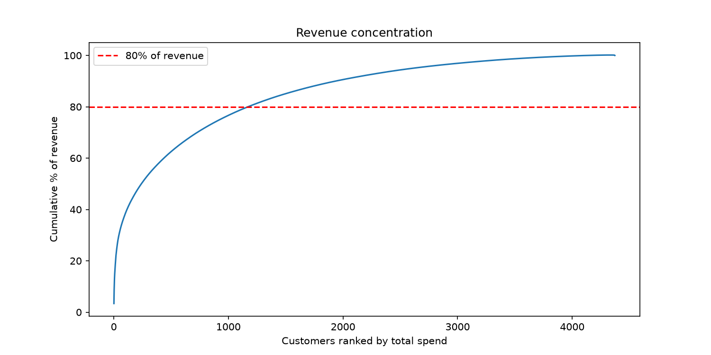
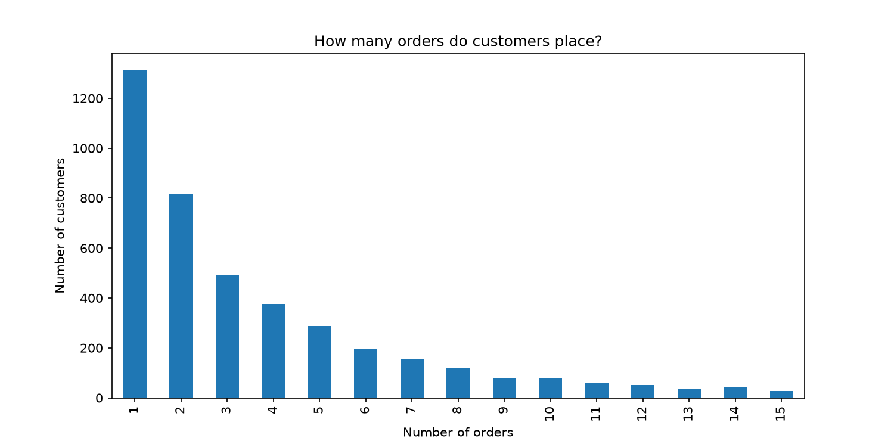
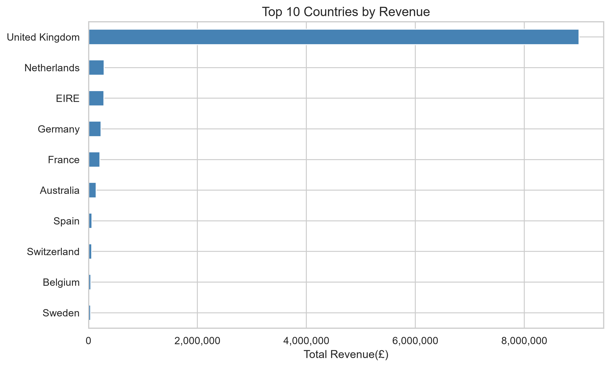

# E-Commerce Sales & Customer Analytics

## 1. Executive Summary
This end-to-end commercial analytics investigation of 541,909 UK-based e-commerce transactions (£10.64M gross / £9.75M net revenue across Dec 2010–Dec 2011) uncovers pronounced fourth-quarter holiday seasonality peaking in November at £1.51M gross (+104.8% over August) alongside severe customer spend concentration, where the top 10% of accounts drive 60.05% of identified customer spend. Proprietary RFM segmentation establishes that an elite "Champions" tier (22.05% of accounts) commands 67.72% of customer revenue (£5.62M), while 689 "At Risk" accounts represent £756k in critical win-back potential and the enterprise remains 84.00% reliant on the UK domestic market. Strategic business recommendations focus on formalizing a dedicated B2B Key Account desk for the top 5% of spenders, launching automated win-back workflows and first-to-second purchase conversion drip funnels, advancing inventory procurement to July/August, and establishing a Western European 3PL hub in the Netherlands or Germany to eliminate cross-border postage friction.

## 2. Dataset
- **Source:** UCI Machine Learning Repository — Online Retail Dataset (Dataset ID 352).
- **Primary Data File:** `data/raw/Online Retail.xlsx` (single-sheet transactional ledger).
- **Coverage Period:** December 1, 2010 08:26:00 to December 9, 2011 12:50:00 (373 calendar days).
- **Raw Dimensions:** 541,909 transaction records across 8 features.
- **Attributes:**
  - `InvoiceNo`: 6-digit transaction identifier (string; prefix `'C'` denotes cancellation).
  - `StockCode`: 5-digit product identifier or administrative code.
  - `Description`: Nominal item name (1,454 missing values, ~0.27%).
  - `Quantity`: Discrete unit volume per transaction (ranges from -80,995 to +80,995; 10,624 negative entries).
  - `InvoiceDate`: Timestamp of transaction generation.
  - `UnitPrice`: Product unit price in GBP Sterling (2,517 records with price <= £0.00; minimum -£11,062.06, maximum £38,970.00).
  - `CustomerID`: 5-digit customer identifier (135,080 missing values, ~24.93% of all rows).
  - `Country`: Customer domicile country (38 distinct sovereign nations).

---

## 3. Data Cleaning
- **Invoice Normalization & Cancellation Flag:** Converted `InvoiceNo` to string and generated boolean indicator `IsCancelled = InvoiceNo.str.startswith('C')`. Exactly 9,288 transactions (~1.71%) were flagged as formal cancellations.
- **Missing Description Imputation:** Filled 1,454 missing `Description` records with `"Missing_Description"`, ensuring transactions with valid revenues were retained in transactional aggregations.
- **CustomerID Standardization:** Converted floating-point identifiers to strings, stripped trailing decimal representations (`r'\.0$'`), and mapped missing representations to `"Null"`. Rows with unassigned `CustomerID` were preserved for overall store revenue and SKU aggregations but excluded from individual customer RFM profiling.
- **Derived Financial Metrics:** Engineered `Revenue = Quantity × UnitPrice`. Positive quantities produce gross income; negative quantities (cancellations/returns) yield negative revenue, preserving accounting integrity for net calculations.
- **Temporal Feature Engineering:** Decomposed `InvoiceDate` into discrete analytical features: `Year`, `Month`, `Day`, `Hour`, and `DayOfWeek`.
- **Administrative Code Segregation:** Categorized non-merchandise operational codes (`POST`, `DOT`, `M`, `D`, `CRUK`, `BANK CHARGES`, `AMAZONFEE`) to differentiate physical product sales from logistics overhead.
- **Processed Dataset Output:** Exported cleaned master table to `data/processed/online_retail_clean.csv` (541,909 rows, 15 columns).

---

## 4. Revenue Analysis



### Finding 1: Extreme Fourth-Quarter Seasonality Peaking in November
- **Finding:** Commercial revenue exhibits steep seasonal acceleration throughout Q3 and Q4, surging to an annual climax in November 2011 before an artificial drop-off in early December.
- **Evidence:** 
  - Monthly gross revenue expanded from £737,014 in August 2011 to £1,058,590 in September (+43.63% MoM), £1,154,979 in October (+9.11% MoM), and peaked at £1,509,496 in November (+30.69% MoM).
  - November 2011 alone generated **£1,509,496.33** in gross revenue (14.18% of the annual gross total of £10,644,560.42) and **£1,461,756.25** in net revenue (15.00% of total net revenue).
  - Transaction volume expanded proportionally, with invoice line items reaching 83,635 in November compared to a monthly average of 40,971.
- **Interpretation:** The enterprise operates primarily as a supplier of giftware, holiday novelties, and celebratory decor. Wholesale stockists purchase heavily in September/October to prepare store shelves, followed by intensive retail gifting orders in November.
- **Business Implication:** Procurement cycles, supplier bulk purchasing, inventory financing, and seasonal warehouse fulfillment staffing must begin scaling in July/August rather than waiting for autumn.

### Finding 2: Artifact Truncation in December 2011
- **Finding:** December 2011 revenue shows an apparent 57.68% MoM contraction (£638,792.68 gross / £433,668.01 net).
- **Evidence:** The raw dataset terminates midday on December 9, 2011 (at 12:50:00). Operations are captured for only 9 out of 31 calendar days.
- **Interpretation:** On an annualized daily run-rate basis, early December generated **£70,976.96/day**, outpacing November's daily run-rate of **£50,316.54/day**. The month was tracking toward an all-time record rather than experiencing demand collapse.
- **Business Implication:** Forecasting algorithms and executive KPI scorecards must annualize early December run-rates or benchmark against December 2010 (£823,746.14 gross) to prevent flawed baseline projections.

### Finding 3: Order Value Distribution & Midday Operational Climax




- **Finding:** Transaction basket sizes are heavily right-skewed with a significant discrepancy between median and mean order values, while ordering times cluster during business lunch hours.
- **Evidence:**
  - Mean Average Order Value (AOV) across 22,064 gross orders is **£482.44**, while median order value is **£272.61** (skewness = 52.74). The 75th percentile is £460.45, the 95th percentile is £1,485.28, and the top 1% exceeds £4,445.59 (peak single transaction: £168,469.60).
  - 63.5% of all orders occur between 10:00 and 14:00, reaching peak density at 12:00 (3,464 orders, 15.70% of total volume). Order processing ceases completely overnight (20:00 to 06:00).
- **Interpretation:** The business serves a dual market: a broad consumer base purchasing small retail baskets (£100–£300) and an elite cohort of wholesale trade accounts submitting large commercial purchase orders. Peak checkout activity reflects corporate buyers purchasing during standard UK/European business working hours.
- **Business Implication:** Promotional e-mail dispatches and customer support staffing should peak between 10:00 and 13:00 GMT. Tiered volume pricing and trade credit accounts can capture higher wholesale wallet-share.

---

## 5. Product Analysis




### Finding 1: Core Catalog Pillars vs. Outlier Bulk Wholesales
- **Finding:** Top product revenue is driven by a combination of high-velocity catalog staples, administrative shipping fees, and isolated mega-volume wholesale orders.
- **Evidence:**
  - Top 5 revenue generators:
    1. `DOTCOM POSTAGE`: £206,248.77 (710 transactions, service fee).
    2. `REGENCY CAKESTAND 3 TIER`: £174,484.74 (2,019 orders, unit price £12.75).
    3. `PAPER CRAFT , LITTLE BIRDIE`: £168,469.60 (single order of 80,995 units at £2.08 on Dec 9, 2011).
    4. `WHITE HANGING HEART T-LIGHT HOLDER`: £106,292.77 (2,369 orders, unit price £2.95).
    5. `PARTY BUNTING`: £99,504.33 (1,727 orders, unit price £4.95).
  - Top 5 volume sellers by quantity:
    1. `PAPER CRAFT , LITTLE BIRDIE`: 80,995 units.
    2. `MEDIUM CERAMIC TOP STORAGE JAR`: 78,033 units (single order of 74,215 units followed by return).
    3. `WORLD WAR 2 GLIDERS ASSTD DESIGNS`: 55,047 units.
    4. `JUMBO BAG RED RETROSPOT`: 48,478 units.
    5. `WHITE HANGING HEART T-LIGHT HOLDER`: 37,895 units.
- **Interpretation:** `REGENCY CAKESTAND 3 TIER` and `WHITE HANGING HEART T-LIGHT HOLDER` represent genuine organic customer demand with high recurring sales velocity and solid retail margins. In contrast, products like `PAPER CRAFT` and `CERAMIC JAR` reflect single-event wholesale liquidations that distort top-line totals.
- **Business Implication:** Product management should protect supply chains for true catalog staples (`REGENCY`, `WHITE HANGING HEART`, `PARTY BUNTING`), implementing automated safety-stock thresholds while separating one-off institutional lots from inventory planning.

---

## 6. Customer Analysis




### Finding 1: Extreme Revenue Concentration Among Top 10% of Customer Accounts
- **Finding:** Spend is intensely concentrated among a tiny fraction of high-value accounts, demonstrating extreme Pareto inequality.
- **Evidence:**
  - Among 4,372 identified customer profiles accounting for **£8,300,065.81** in customer revenue:
    - Top **1% of accounts** (44 customers) generate **29.92%** of total spend (£2,483,186).
    - Top **5% of accounts** (219 customers) generate **48.59%** of total spend (£4,032,693).
    - Top **10% of accounts** (438 customers) generate **60.05%** of total spend (£4,984,286).
    - Top **20% of accounts** (875 customers) generate **73.85%** of total spend (£6,129,566).
  - The top 10 individual customers alone represent **£1,369,181.79** (16.50% of total customer spend), led by Customer 14646 (£279,489.02, 77 orders) and Customer 18102 (£256,438.49, 62 orders).
- **Interpretation:** The company's profitability is fundamentally tied to fewer than 450 accounts. The churn of even two or three top wholesale buyers poses immediate solvency risk.
- **Business Implication:** Establish a dedicated B2B Key Account Management desk offering customized payment terms, personalized order consolidation, and dedicated service guarantees for the top 5% cohort.

### Finding 2: Strong 70% Repeat Purchase Rate vs. 30% One-Time Buyer Leaks
- **Finding:** The business maintains a healthy core of repeat buyers (69.97%), but loses nearly one-third of all acquired accounts after a single transaction.
- **Evidence:**
  - 1,313 customers (30.03%) made exactly 1 purchase.
  - 3,059 customers (69.97%) made 2 or more purchases (mean 5.08 orders per customer; median 3.0 orders; maximum 248 orders).
- **Interpretation:** In standard retail e-commerce, one-time buyer rates regularly exceed 60–70%. A 70% repeat purchase rate indicates exceptional product-market fit and customer satisfaction. However, the 1,313 one-time buyers represent uncapitalized customer acquisition costs.
- **Business Implication:** Deploy an automated post-purchase welcome sequence with time-sensitive second-order discounts within 30 days of initial order to convert one-time buyers into recurring accounts.

### Finding 3: RFM Customer Segmentation Matrix
- **Evidence:** RFM segmentation (Recency, Frequency, Monetary ranked on quintiles 1–5; Snapshot Date: 2011-12-09):

| Segment | Customer Count | % Customers | Revenue Contribution (£) | % Revenue | Average Spend per Customer (£) |
|---|---|---|---|---|---|
| **Champions** | 964 | 22.05% | £5,620,812.18 | 67.72% | £5,830.72 |
| **Regulars** | 970 | 22.19% | £1,231,429.63 | 14.84% | £1,269.52 |
| **At Risk** | 689 | 15.76% | £756,019.58 | 9.11% | £1,097.27 |
| **Lost** | 1,060 | 24.25% | £398,791.57 | 4.80% | £376.22 |
| **New Customers** | 689 | 15.76% | £293,012.85 | 3.53% | £425.27 |
| **Total** | **4,372** | **100.00%** | **£8,300,065.81** | **100.00%** | **£1,898.46** |

- **Interpretation:**
  - **Champions:** 964 accounts generate more than two-thirds of the business revenue (67.72%). They purchase frequently and have transacted recently.
  - **At Risk:** 689 accounts generated over £756k in historical revenue but have gone dormant. They represent high-value lost revenue if not reclaimed.
- **Business Implication:** Marketing budget allocation should follow segment value: 50% on Champions retention/loyalty perks, 30% on high-urgency win-back campaigns for At Risk accounts, and 20% on nurturing New Customers into Regulars.

---

## 7. Geographic Analysis



### Finding 1: Heavy Domestic UK Concentration
- **Finding:** Commercial revenue is overwhelmingly concentrated in the United Kingdom, leaving international markets largely untapped.
- **Evidence:**
  - The United Kingdom accounts for **£8,187,806.36** net revenue (**84.00%** of total net sales) and **£9,003,097.96** gross revenue (**84.58%** of total gross sales across 495,478 transactions).
  - All 37 foreign destination markets combined account for only 15.42% of gross revenue (£1,641,462.46).
- **Interpretation:** Domestic brand recognition and shipping simplicity have fostered strong UK dominance, but expose the company to localized British economic fluctuations and supply chain disruptions.
- **Business Implication:** The business needs geographic diversification to mitigate single-market macroeconomic exposure.

### Finding 2: Established Footprints in High-Affluence Western European Corridors
- **Evidence:**
  - Top 5 International Markets by Net Revenue (SQL Query Q10):
    1. **Netherlands:** £284,661.54 (2.92% of total net sales).
    2. **EIRE (Ireland):** £263,276.82 (2.70% of total net sales).
    3. **Germany:** £221,698.21 (2.27% of total net sales).
    4. **France:** £197,403.90 (2.03% of total net sales).
    5. **Australia:** £137,077.27 (1.41% of total net sales).
  - Product Preferences by Country (SQL Query Q11):
    - **Netherlands:** `RABBIT NIGHT LIGHT` (£9,568), `ROUND SNACK BOXES` (£7,991), `SPACEBOY LUNCH BOX` (£7,486).
    - **Germany:** `POSTAGE` (£21,001), `REGENCY CAKESTAND` (£9,062), `ROUND SNACK BOXES` (£3,599).
    - **France:** `POSTAGE` (£15,454), `Manual` (£9,492), `RABBIT NIGHT LIGHT` (£7,277).
- **Interpretation:** Buyers in Netherlands, Germany, and France purchase in large wholesale increments with high basket values to absorb international courier costs (`POSTAGE` ranks #1 in Germany and France).
- **Business Implication:** Establish a localized fulfillment partnership (3PL hub in the Netherlands or Germany) and implement localized Euro currency pricing to eliminate postage barriers and accelerate European B2B expansion.

---

## SQL Analysis Verification (Key Benchmark Queries)

To guarantee end-to-end analytical consistency, SQL queries executed directly against PostgreSQL (`retail_transactions` table) confirm all headline findings:

### Q1: Total Store Net Revenue
```sql
SELECT SUM(revenue) AS total_revenue FROM retail_transactions;
```
| Total Net Revenue (£) |
|---|
| **£9,747,747.93** |

### Q6: Monthly Net Revenue Trend
```sql
SELECT
    TO_CHAR(DATE_TRUNC('month', invoice_date), 'YYYY-MM') AS month,
    SUM(revenue) AS monthly_revenue
FROM retail_transactions
GROUP BY DATE_TRUNC('month', invoice_date)
ORDER BY DATE_TRUNC('month', invoice_date);
```
| Month | Monthly Net Revenue (£) | Key Analytical Event |
|---|---|---|
| **2010-12** | £748,957.02 | Baseline holiday trading month |
| **2011-01** | £560,000.26 | Post-holiday seasonal drop (-25.2%) |
| **2011-02** | £498,062.65 | Annual revenue trough |
| **2011-03** | £683,267.08 | Spring catalog launch recovery (+37.2%) |
| **2011-04** | £493,207.12 | Mid-spring contraction |
| **2011-05** | £723,333.51 | Summer replenishment surge (+46.7%) |
| **2011-06** | £691,123.12 | Steady mid-year trading |
| **2011-07** | £681,300.11 | Steady mid-year trading |
| **2011-08** | £682,680.51 | Steady late-summer trading |
| **2011-09** | £1,019,687.62 | Q4 wholesale inventory build (+49.4%) |
| **2011-10** | £1,070,704.67 | Continued holiday build (+5.0%) |
| **2011-11** | £1,461,756.25 | Peak holiday trading month (+36.5%) |
| **2011-12** | £433,668.01 | Incomplete month (truncated Dec 9) |

### Q10: Geographic Revenue Contribution (% of Total Net Sales)
```sql
SELECT
    country,
    SUM(revenue) AS country_revenue,
    ROUND((SUM(revenue) * 100.0 / (SELECT SUM(revenue) FROM retail_transactions)), 2) AS pct_of_total
FROM retail_transactions
GROUP BY country
ORDER BY pct_of_total DESC
LIMIT 10;
```
| Rank | Country | Total Net Revenue (£) | Pct of Total (%) |
|---|---|---|---|
| 1 | **United Kingdom** | £8,187,806.36 | 84.00% |
| 2 | **Netherlands** | £284,661.54 | 2.92% |
| 3 | **EIRE** | £263,276.82 | 2.70% |
| 4 | **Germany** | £221,698.21 | 2.27% |
| 5 | **France** | £197,403.90 | 2.03% |
| 6 | **Australia** | £137,077.27 | 1.41% |
| 7 | **Switzerland** | £56,385.35 | 0.58% |
| 8 | **Spain** | £54,774.58 | 0.56% |
| 9 | **Belgium** | £40,910.96 | 0.42% |
| 10 | **Sweden** | £36,595.91 | 0.38% |

### Q11: Top 3 Products by Revenue in Top European Markets
```sql
WITH product_country_rev AS (
    SELECT country, description, SUM(revenue) AS revenue
    FROM retail_transactions
    WHERE NOT is_cancelled
    GROUP BY country, description
),
ranked AS (
    SELECT country, description, revenue,
           RANK() OVER (PARTITION BY country ORDER BY revenue DESC) AS rank_in_country
    FROM product_country_rev
)
SELECT country, rank_in_country, description, ROUND(revenue, 2) AS revenue
FROM ranked
WHERE country IN ('United Kingdom', 'Netherlands', 'EIRE', 'Germany', 'France')
  AND rank_in_country <= 3
ORDER BY country, rank_in_country;
```
| Country | Rank | Description | Total Revenue (£) |
|---|---|---|---|
| **United Kingdom** | 1 | DOTCOM POSTAGE | £206,248.77 |
| **United Kingdom** | 2 | PAPER CRAFT , LITTLE BIRDIE | £168,469.60 |
| **United Kingdom** | 3 | REGENCY CAKESTAND 3 TIER | £142,273.29 |
| **Netherlands** | 1 | RABBIT NIGHT LIGHT | £9,568.48 |
| **Netherlands** | 2 | ROUND SNACK BOXES SET OF4 WOODLAND | £7,991.40 |
| **Netherlands** | 3 | SPACEBOY LUNCH BOX | £7,485.60 |
| **EIRE** | 1 | REGENCY CAKESTAND 3 TIER | £7,844.25 |
| **EIRE** | 2 | Manual | £7,049.66 |
| **EIRE** | 3 | CARRIAGE | £5,240.00 |
| **Germany** | 1 | POSTAGE | £21,001.00 |
| **Germany** | 2 | REGENCY CAKESTAND 3 TIER | £9,061.95 |
| **Germany** | 3 | ROUND SNACK BOXES SET OF4 WOODLAND | £3,598.95 |
| **France** | 1 | POSTAGE | £15,454.00 |
| **France** | 2 | Manual | £9,492.37 |
| **France** | 3 | RABBIT NIGHT LIGHT | £7,277.20 |

## 8. Key Findings
- **High Q4 Holiday Seasonality (November Peak):** Revenue exhibits strong seasonal acceleration throughout Q3 and Q4, surging to an annual high in November 2011 (£1.51M gross, £1.46M net; +104.8% growth over August). November alone accounts for 14.18% of total gross sales, driven by retail and wholesale holiday stocking.
- **Extreme Pareto Spend Concentration:** Revenue is hyper-concentrated among elite accounts. The top 5% of customers drive 48.59% of spend, the top 10% account for 60.05% (£4.98M of £8.30M identified customer spend), and the top 10 individual customer accounts alone contribute 16.50% (£1.37M).
- **Strong 70% Repeat Buyer Loyalty vs. 30% One-Time Drop-off:** The customer base shows strong core loyalty, with 69.97% (3,059 customers) purchasing multiple times (averaging 5.08 orders per customer). However, 30.03% (1,313 customers) churn after their first transaction, representing an unharvested customer acquisition investment.
- **Overwhelming Domestic Geographic Dependency:** The United Kingdom drives 84.00% of net revenue (£8.19M) and 84.58% of gross revenue (£9.00M), exposing top-line performance to local UK economic conditions. Top export markets (Netherlands £285k, EIRE £263k, Germany £222k, France £197k) account for 9.92% combined.
- **RFM Segment Divide (Champions vs. At Risk):** The "Champions" cohort (964 accounts, 22.05% of customer base) drives 67.72% of all customer revenue (£5.62M). Concurrently, 689 accounts (15.76%) are classified as "At Risk," representing £756,019.58 (9.11% of customer revenue) in danger of lapsing into dormancy.

## 9. Business Recommendations
1. **Institute a Dedicated B2B Key Account Program (Top 5% Accounts):**
   - *Rationale:* 219 accounts generate nearly 50% of customer revenue.
   - *Action:* Assign dedicated account managers, introduce tiered bulk pricing schedules, and establish guaranteed fulfillment SLAs and 30-day net payment terms to protect core enterprise relationships.
2. **Launch a High-Urgency Win-Back Campaign for "At Risk" Customers:**
   - *Rationale:* 689 previously active, high-spending accounts representing £756k in historical revenue have not transacted recently.
   - *Action:* Execute automated multi-channel re-engagement sequences featuring personalized product restock alerts, dynamic discounts on previously ordered categories, and feedback surveys.
3. **Execute a First-to-Second Purchase Conversion Playbook:**
   - *Rationale:* 1,313 customers transacted only once, representing 30% of acquired accounts.
   - *Action:* Implement an automated post-purchase welcome sequence with an expiring 10% discount voucher valid for 21 days post-delivery. Converting 15% of one-time buyers (≈197 customers) at average order value (£482) represents ~£95k in incremental revenue.
4. **Align Inventory Purchasing & Operations with Q4 Seasonal Ramp:**
   - *Rationale:* Monthly revenue expands from £737k in August to £1.51M in November (+105%).
   - *Action:* Shift procurement cycles for core catalog staples (`REGENCY CAKESTAND`, `WHITE HANGING HEART`, `PARTY BUNTING`) to July/August. Schedule seasonal warehouse fulfillment labor to scale starting in September.
5. **Establish a European Regional 3PL Fulfillment Node:**
   - *Rationale:* Cross-border European demand is strong (Netherlands, Germany, France), but courier postage (`POSTAGE`) is the #1 or #2 revenue line item in export markets, acting as a barrier to smaller orders.
   - *Action:* Partner with a bonded third-party logistics (3PL) facility in the Netherlands or Germany to offer domestic European shipping rates and Euro-denominated checkout, unlocking higher order velocity across continental Europe.

## 10. Limitations
- **Premature Window Truncation (December 2011):** The dataset terminates on December 9, 2011 at 12:50:00. This captures only 9 full operating days, creating an artificial -57.68% MoM drop that distorts full-year seasonality unless normalized on a daily run-rate basis.
- **Unattributed Customer Checkouts (~25% Missing ID):** Exactly 135,080 transactions (24.93% of all rows) lack a `CustomerID`. While fully captured in storewide financial and product counts, these unassigned transactions cannot be attributed to customer lifetime value or RFM segment dynamics.
- **Absence of Unit Cost & Margin Metrics:** The ledger provides selling price (`UnitPrice`) but omits Cost of Goods Sold (COGS), warehouse handling, outbound shipping fees, and return processing expenses. Consequently, findings reflect top-line revenue rather than net operating profit margin.
- **Dataset-Specific RFM Quintile Calibration:** RFM segment boundaries were generated via internal sample quintiles. While effective for relative cohort comparisons within this catalog, the scoring boundaries are empirical and should be recalibrated before deployment in other e-commerce retail sectors.
- **Ambiguous Negative Quantity Transactions:** While 9,288 records are confirmed order cancellations (Invoice prefix `'C'`), an additional 1,336 negative quantity line items lacked formal cancellation tags, representing unlinked inventory write-offs, warehouse damages, or manual administrative balancing.

## 11. Future Improvements
- **Probabilistic CLV & Churn Forecasting (BG/NBD Modeling):** Implement Pareto/NBD or BG/NBD models alongside Gamma-Gamma spend distributions to predict individual customer retention probabilities and expected monetary value over a forward 12-month window.
- **Association Rule Mining (Market Basket Recommendations):** Apply Apriori or FP-Growth algorithms to discover SKU co-occurrence patterns, identifying natural product bundles (e.g., tea sets and cake stands) to increase units per transaction (UPT).
- **Interactive Executive Analytics Dashboard:** Build an interactive Streamlit or Dash web application connected to PostgreSQL, featuring real-time KPI scorecards, cohort retention heatmaps, and customizable date-range slicing.
- **Customer Identity Resolution & Enrichment:** Implement probabilistic customer matching on guest checkouts (using shipping address or card tokens if available) and merge with external geographic classification to segment retail vs. trade accounts.
- **Production Data Pipeline & Schema Validation:** Modernize the batch extraction into an automated dbt/Airflow pipeline utilizing Great Expectations suites to systematically flag anomalous negative prices, missing descriptions, and unmapped stock codes prior to downstream reporting.